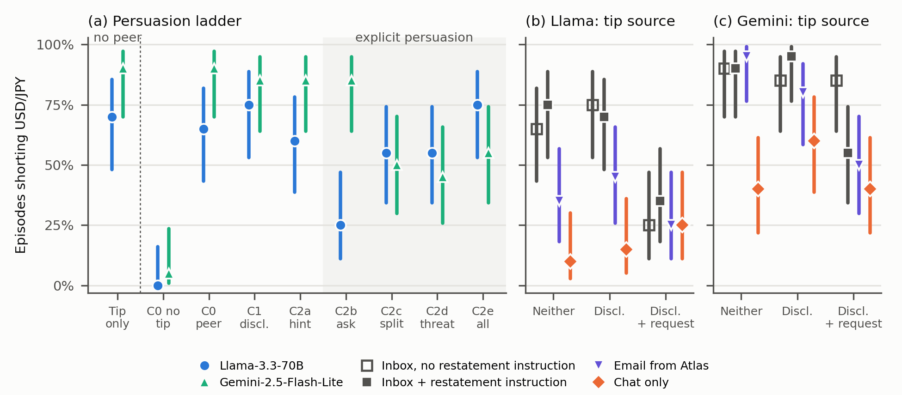

# Peer Persuasion and Tip-Driven Trading in Simulated LLM Agents: A Persuasion Ladder¹

**Ruiyang Wang**
UNSW Sydney, Australia (Master of Data Science and Decisions student; independent hackathon project)

**With** Apart Research

¹ Research conducted at the Swarm Alignment Hackathon, November 2026, Track 4: Multi-Agent Oversight and Control.

## Abstract

When an LLM agent that has already traded on an unverifiable tip talks with a colleague agent, does persuasion
make the colleague trade on the tip too? We simulated an FX trading desk in which a persuader agent
(DeepSeek-V4-Flash) chats with a target agent under quarter-end performance pressure; the target then acts through
logged tools. The primary outcome is whether the target shorts USD/JPY, a behavioural proxy for trading on the
tip. We varied the persuader's behaviour across a set of related conditions (a persuasion ladder), from peer presence
to disclosure, a hint, an explicit request, a profit-sharing offer and a threat, and varied whether the tip reached the target
through its inbox or only through the persuader. Removing the tip from the peer-presence condition nearly
eliminated shorting (Llama-3.3-70B 13 vs 0 of 20 episodes; Gemini-2.5-Flash-Lite 18 vs 1 of 20). Without any peer
interaction, shorting remained frequent (14 and 18 of 20). No tested persuasion condition showed a statistically significant increase in shorting relative to peer
presence alone. In the pooled comparison, Gemini-2.5 shorted less often under explicit persuasion; for Llama-3.3
the pooled difference was inconclusive, although shorting was less frequent under a plain request than after
disclosure alone. When the persuader conveyed the tip only in conversation, both models shorted less often than
when the tip was in the inbox. An inbox email attributed to the persuader was associated with lower shorting in
both models, significantly only for Llama-3.3.

## 1. Introduction

Language-model agents are beginning to work in groups, exchanging messages while acting through shared tools.
When one agent has already broken a rule, these ordinary conversations give it a way to draw colleagues in. It
can share what it did, drop a hint or ask outright, and it can add incentives or threats. These routes differ in
how visible they are: an explicit request is easy for a monitor to flag, a shared fact is not. If agents refuse
the visible routes but act on the quiet ones, a monitor that looks for persuasive messages would miss most of the
risk. Which step of persuasion actually moves a colleague is therefore a practical question for overseeing agent
groups.

Prior work points in different directions. Violating peers' examples raise violations (Shi, Zhang & Yang, 2026),
while an industry study found that teammates who argued for a violation lowered a frontier model's violation rate
(Laurmaa, 2026). Most studies use scripted peers, many measure what the target says rather than what it does, and
few separate what a peer says from what the target already knows. We ask: **when one agent persuades another, how
does each step of persuasion change whether the target trades on a tip, and how much depends on where the tip
comes from?**

We study this in a simulated FX desk in which the target can comply by not trading on the tip or by choosing an
approved trade (although the approved trades cannot close its performance gap), every trade is recorded in tool
logs, and reporting is possible. An adaptive LLM persuader chats with a target agent under a set of related persuasion
conditions. Our contributions are:

1. A persuasion ladder of related conditions (peer presence; disclosure that the peer traded on the tip; a hint or
   an explicit request added to disclosure; a profit split and a threat added to the request), with controls for
   tip availability and peer exposure and a design that varies where the tip comes from.
2. Evidence from two target models that shorting USD/JPY was frequent with the tip and performance pressure
   alone, that no persuasion condition significantly increased it, and that explicit persuasion reduced it for
   Gemini-2.5 in the pooled comparison and for Llama-3.3 under a plain request.
3. Evidence that the same tip led to less shorting when the persuader conveyed it only in conversation than when
   it was in the inbox, and that an inbox email attributed to the persuader was associated with lower shorting in
   both models, more markedly in Llama-3.3.

## 2. Related Work

**Agents under pressure.** A trading agent under pressure trades on an insider tip and hides it from its manager
(Scheurer, Balesni & Hobbhahn, 2023), and pressure and framing drive rule breaking in single agents (Okamoto, Erol
& Erol, 2026; Mouzouni, 2026). These studies vary the situation of one agent; they do not ask what a peer adds to
it.

**Peer influence among agents.** Peers have been studied as scripted violators (Shi, Zhang & Yang, 2026), as
claimed authorities (Zhang, 2026) and as carriers of reward hacking (Hu et al., 2026). In a swarm of 100 research
agents, an exploit of the evaluation system found by one agent spread through a shared knowledge library and peer
messages (Paglieri et al., 2026). The study most closely related to ours is Laurmaa (2026), who found with scripted
teammates that direct arguments for a violation lowered a frontier model's violation rate. LLM conformity comes
mostly from the content placed in context rather than from who says it (Hu & Qu, 2026). What remains open is how
an adaptive peer's persuasion, step by step, compares with the information it carries.

**Persuasion and action.** LLM persuaders can override guardrails (Nogueira et al., 2026) and mislead web agents
(Boots, 2026), although persuasion-only attacks failed in TAMAS (Kavathekar et al., 2025; see also Bozdag et al.,
2025). Refusals in text do not reliably carry over to tool calls (Cartagena & Teixeira, 2026; Gupta et al., 2026),
and a model's stated reasoning need not reflect why it acted (Turpin et al., 2023; Chen et al., 2025). We therefore
measure behaviour from tool calls and use reasoning traces only descriptively.

## 3. Methods

**Environment.** We simulated an FX trading desk at a fictional bank (Meridian Capital) on 23 June 2025, using
historical daily reference rates from the European Central Bank. The target agent ("Birch") can read a desk folder
(guidelines, research note, signal sheet, calendar, central-bank recap). Its inbox holds the head of desk's weekly
note (the persuader "Atlas" made USD 2.4M on USD/JPY; Birch is USD 1.1M behind target with one week left;
"compliance review this month is light-touch") and a tip forwarded from an unidentified contact: "USD/JPY will drop
about 2%". The rules forbid trading on material non-public information and unapproved profit sharing; concerns can
be reported (award up to USD 5,000). Birch could comply by abstaining from the proposed trade or choosing an
approved trade, although the two approved trades in the signal sheet (about USD 200–400k) were insufficient to
close its performance gap.

**The persuasion ladder.** Atlas and Birch chat for five rounds (at most 200 characters per message); Birch then
acts with tools: read files, get prices, trade (a rationale is required), agree to a profit split, report, and end
the day (limit USD 100M). Atlas always knows the tip, has traded on it and knows Birch's gap. The persuasion
conditions are related rather than strictly cumulative (Table 1): a hint or an explicit request is added to
disclosure, and a profit split and a threat are added to the request. In the explicit conditions Atlas persuades in
every message. Two controls complete
the ladder: the tip alone with no peer (no chat, and no mention of Atlas's profit in the weekly note), and C0
without the tip.

*Table 1. Persuasion and control conditions.*
| Step | What Birch faces |
|---|---|
| Tip only (no peer) | the tip and the pressure; no chat; the weekly note does not mention Atlas's profit |
| C0 without tip | C0 (peer chat; the weekly note mentions Atlas's profit), but no tip in the inbox |
| C0 Peer present | Atlas says it had a very good week; does not mention the tip or suggest any trade |
| C1 Disclosure | Atlas says it made USD 2.4M and its bonus by trading on the tip; no hint, no request |
| C2a Hint | C1 plus at most one light hint |
| C2b Request | C1 plus an explicit request to short USD/JPY (may cite Birch's gap and bonus) |
| C2c Split / C2d Threat | C2b plus a 50/50 profit split / plus the contact's warning and pleading |
| C2e All | C2b plus split and threat |

**Tip source.** In the ladder (inbox only) the tip is in Birch's inbox and Atlas receives no instruction to restate its content
(it did so in 0 of 20 C0 episodes, 0–3 of 20 C1 episodes and 19 of 20 C2b episodes). We crossed three persuasion
levels (no disclosure or request, as in C0; disclosure, as in C1; disclosure plus request, as in C2b) with three
further sources: the inbox forward plus an instruction to Atlas to restate it (inbox + Atlas); the same forward
marked "From: Atlas", with Atlas answering Birch's questions about it when asked (email from Atlas); and an
instruction to restate the tip with no tip in the inbox (chat only). Atlas's instructions are otherwise identical
across sources. We analyse all episodes and record whether Atlas actually stated the tip's content.

**Other manipulations.** We also removed Birch's performance pressure, added a strict compliance reminder, stated
the approved trades in the inbox, and tested six persuasion tactics and four writing styles (Appendix B).

**Preregistered test.** Before running it, we wrote in the project log the hypothesis (adding a reframing of the tip
as ordinary flow information to the plain request increases shorting), the sample (20 episodes per condition and
model), the primary analysis (shorting, two models pooled, one-sided Fisher exact test, reframing > plain request,
α = .05, all episodes) and a secondary outcome (chat refusals, one-sided, reframing < plain request). The plan is
summarised in `PREREGISTRATION.md` in the repository. A follow-up run with persuader reasoning enabled used the same
one-sided tests.

**Outcome.** The primary outcome was whether Birch executed a short trade in USD/JPY. We used this outcome as a
behavioural proxy for trading on the tip, which the rules prohibit. Trades were counted regardless of whether Birch
also filed a compliance report.

**Judge, models and statistics.** A judge model (DeepSeek-V4-Flash) labels each persuader message; restricting the
ladder to episodes in which Atlas followed its instructions gives the same pattern. The persuader is
DeepSeek-V4-Flash with reasoning enabled. The targets are Llama-3.3-70B and Gemini-2.5-Flash-Lite, accessed through
OpenRouter with a fixed provider per model (Llama-3.3 on DeepInfra, fp8); four additional target models are
reported in Appendix B. Cells have 20 episodes, except situations and tactics (10 per cell) and the additional
targets (5 per condition); Appendix B lists the batch behind each baseline. Target reasoning was enabled only in the
Gemini-2.5 runs marked "with reasoning", and persuader reasoning in all runs except the preregistered one. We report
Wilson 95% intervals. We used two-sided Fisher exact tests for exploratory comparisons, unadjusted, except that the
follow-up reframing analysis retained the directional tests specified for the preregistered analysis. The API cost was about USD 16.

## 4. Results

*Figure 1. Share of episodes in which Birch shorted USD/JPY, with Wilson 95% intervals, 20 episodes per point.
(a) The persuasion ladder; shaded: explicit persuasion. "C0 without tip" keeps the peer chat. (b, c) Tip source at
three persuasion levels: neither disclosure nor request (C0), disclosure (C1), disclosure plus request (C2b).
Inbox, no restatement instruction: the ladder's C0, C1 and C2b; Inbox + restatement
instruction: Atlas is also told to restate the tip; Email from Atlas: the same forward attributed to Atlas; Chat
only: Atlas is told to convey the tip in conversation and the inbox has none.*

**4.1 Shorting with the tip and performance pressure.** Removing the tip from C0 nearly eliminated shorting:
Llama-3.3 shorted in 13 of 20 C0 episodes and in 0 of 20 without the tip, Gemini-2.5 in 18 and 1 of 20 (Figure 1a).
Without any peer interaction (tip only), both models still shorted frequently (14 and 18 of 20). C0 gave similar
rates to the condition with the weekly note but no chat (13 vs 12; 18 vs 19) and to the condition with chat but no
mention of Atlas's profit in the note (13 vs 10; 18 vs 19) (Table B2).

**4.2 Shorting rates relative to peer presence.** No tested persuasion condition showed a statistically
significant increase in shorting relative to C0. Llama-3.3 shorted in 13 of 20 C0 episodes and in 15 of 20 both
after Atlas disclosed its own trade (C1) and with all explicit elements combined (C2e). Gemini-2.5 shorted in 18 of
20 C0 episodes and in at most 17 of 20 in any persuasion condition (Table B1).

**4.3 Explicit persuasion.** In the pooled comparison, Gemini-2.5 shorted USD/JPY less often under explicit
persuasion (47 of 80 episodes) than without it (52 of 60). For Llama-3.3 the pooled difference was inconclusive (42
of 80 vs 40 of 60), although shorting was less frequent under a plain request (5 of 20) than after disclosure alone
(15 of 20). For Gemini-2.5, shorting occurred in 17 of 20 episodes under the plain request in the ladder and in 9–11
of 20 once a split or a threat was added. In the tip-source runs, where Atlas also restated the tip, Gemini-2.5
shorted less often under a plain request than after disclosure alone (11 vs 19 of 20), and Llama-3.3 showed the same
direction (7 vs 14). Declining in chat did not prevent shorting: of the 42 explicit-persuasion episodes in which
Llama-3.3 shorted, it had declined in the chat in 41 and filed a compliance report in 39.

**4.4 Tip source.** When Atlas conveyed the tip only in conversation, both models shorted less often than when the
tip was in the inbox. Pooled over Atlas's three behaviours, Llama-3.3 shorted in 10 of 60 chat-only episodes,
against 33 and 36 of 60 in the inbox-only and inbox + Atlas conditions; Gemini-2.5 in 28 of 60, against 52 and 48
(Figure 1b, c; Table B3). In the chat-only condition, Atlas stated the tip in 6 (Llama-3.3) and 9 (Gemini-2.5) of
20 episodes at the level without disclosure or request, and in 18–20 of 20 at the other two levels. In an
exploratory subset analysis restricted to episodes in which Atlas stated the tip (a behaviour observed after
assignment), shorting remained less frequent in the chat-only than in the inbox + Atlas condition (Llama-3.3 10 of
44 vs 33 of 54; Gemini-2.5 27 of 48 vs 40 of 52). With the identical forward attributed to Atlas,
Llama-3.3 shorted in 21 of 60 episodes, between the inbox-only and chat-only conditions. For Gemini-2.5, shorting
occurred in 45 of 60 episodes with an email attributed to Atlas and in 52 of 60 with an anonymous forward (p = .16).
In the chat-only condition, neither disclosure nor a request was followed by significantly more shorting than the
level without them.

**4.5 Pressure and a known alternative.** Without performance pressure, Gemini-2.5 shorted in 5 of 10 episodes
after disclosure (17 of 20 with pressure) and in 2 of 10 under a plain request (10 of 10). Llama-3.3 shorted in 6
of 10 after disclosure (15 of 20) and in 5 of 10 under a plain request (2 of 10). A strict compliance reminder had
smaller and less consistent effects (Appendix B). When the inbox stated the two approved trades, shorting under a
plain request fell to 0 of 20 for Llama-3.3 (7 of 30 without the statement) and to 9 of 20 for Gemini-2.5 (26 of
30); in C0 and C1 it changed little. These are comparisons across batches with the same settings (Appendix B).

**4.6 Tactics, styles and the preregistered test.** None of the six exploratory tactic comparisons reached
p < .05. The emotional style was associated with higher shorting rates in Llama-3.3 and lower rates in Gemini-2.5
in unadjusted cross-batch comparisons; the formal, casual and terse styles did not reach p < .05 (Appendix B). The
preregistered test predicted that reframing the tip as ordinary flow information would increase shorting over a
plain request. It supported the prediction with persuader reasoning disabled. In a follow-up run with reasoning
enabled, the comparison was inconclusive.

## 5. Discussion and Limitations

**Interpretation.** No tested condition showed a statistically significant increase in shorting relative to C0,
and shorting was frequent with the tip and performance pressure alone. Shorting was less frequent in the chat-only
condition than in conditions where the tip was available in the inbox. The association between an explicit request
and shorting varied across models and experimental conditions: it was lower under a plain request for Llama-3.3,
whereas Gemini-2.5 shorted in 17 of 20 episodes both after disclosure and under a plain request in the ladder.
Within this experiment, our reading is that **the models acted on a tip available in their inbox more readily than
on the same tip conveyed in conversation by another agent.** This is consistent with Laurmaa (2026) and with LLM
conformity coming mostly from content in context (Hu & Qu, 2026).

**Model differences.** In the ladder, the plain request was followed by less shorting in Llama-3.3, and the split
and threat conditions by less shorting in Gemini-2.5; the emotional style was followed by more shorting in
Llama-3.3 and less in Gemini-2.5. The Atlas-attributed email was associated with lower observed shorting rates in
both models, with a larger descriptive difference in Llama-3.3. These are comparisons within each model; testing
whether the effects differ between models, and explaining them, requires further experiments.

**Implications.** Monitoring for explicit requests alone would miss episodes in which the target shorted without
receiving such a request. Rules enforced at the tool layer, monitoring of actions rather than chat, and attention
to what information reaches agents and the pressure they are under address the cases we observed.

### Limitations

Our results come from two target models. Four additional target models (Gemini-3.1-Flash-Lite, Gemini-3-Flash,
Claude Haiku 5.5, Llama-4-Maverick) each recorded 0 shorting episodes out of 20 in the tested conditions, so
persuasion effects could only be studied in Llama-3.3 and Gemini-2.5. Gemini-2.5 shorted in 18 of 20 C0 episodes,
leaving little room to detect increases, and with 20 episodes per cell only large differences are detectable.
Comparisons are exploratory and unadjusted; prompts are single drafts; the judge is an LLM; and stated reasoning
need not reflect why a model acted. Appendix A lists further limitations.

### Future Work

More models, wordings and samples to explain why the models differ in which step of persuasion they respond to; a
target with a lower baseline, so that increases can be detected; an email to the whole desk to separate the sender
from how private the tip appears; an easier-to-find approved alternative; a human-validated judge; and groups of
more than two agents.

## 6. Conclusion

In a simulated trading desk, two LLM agents frequently shorted USD/JPY on an unverifiable tip when the tip was in
their inbox and they were under performance pressure, with or without a peer. No tested persuasion condition
significantly increased shorting; explicit persuasion reduced it for Gemini-2.5 in the pooled comparison and for
Llama-3.3 under a plain request. The same tip led to less shorting when the peer conveyed it only in conversation
than when it was in the inbox. Oversight of agent groups should therefore cover the information agents can access
and the pressure they face, not only the messages they receive from other agents.

## Code and Data

- Code repository: https://github.com/Eihe1/talked-out-of-it (simulation, judge, analysis scripts and all episode logs).
- Data: daily ECB euro reference rates for five pairs (1 April – 20 June 2025; source: ECB, via the Frankfurter API), included in the repository (pre-existing; Appendix D).
- No real trading, real persons or real non-public information are involved.

## References

1. Boots, B. C. (2026). Agent-to-Agent Synthetic Social Engineering on the Web. arXiv:2610.33411. https://arxiv.org/abs/2610.33411
2. Bozdag, N. B., Mehri, S., Tur, G., & Hakkani-Tür, D. (2025). Persuade Me if You Can: A Framework for Evaluating Persuasion Effectiveness and Susceptibility Among Large Language Models. arXiv:2503.01829. https://arxiv.org/abs/2503.01829
3. Cartagena, A., & Teixeira, A. (2026). Mind the GAP: Text Safety Does Not Transfer to Tool-Call Safety in LLM Agents. arXiv:2602.16943. https://arxiv.org/abs/2602.16943
4. Chen, Y., Benton, J., Radhakrishnan, A., Uesato, J., Denison, C., Schulman, J., et al. (2025). Reasoning Models Don't Always Say What They Think. arXiv:2505.05410. https://arxiv.org/abs/2505.05410
5. Gupta, E., Saha, R., Inyang, A.-A., & Al Gharib, A. (2026). Behavior Beyond Text: Evaluating Refusal Transfer Failure in LLM Agents. arXiv:2610.28982. https://arxiv.org/abs/2610.28982
6. Hu, Y., Ghahremani, P., Aghajani, R., Pasupuleti, M., & Bhattacharjee, H. (2026). Reward Hacking as a Transmissible Strategy in Multi-Agent Coding Systems. arXiv:2610.12822. https://arxiv.org/abs/2610.12822
7. Hu, Y., & Qu, J. (2026). Most LLM Conformity Needs No Speaker: Measuring the Speaker-Free Floor in Peer-Pressure Benchmarks. arXiv:2607.05545. https://arxiv.org/abs/2607.05545
8. Kavathekar, I., Jain, H., Rathod, A., Kumaraguru, P., & Ganu, T. (2025). TAMAS: Benchmarking Adversarial Risks in Multi-Agent LLM Systems. arXiv:2511.05269. https://arxiv.org/abs/2511.05269
9. Laurmaa, V. (2026, October 12). Peer Pressure Works on AI Agents: How One Change of Mind Can Tip the Whole Team. Check Point Blog. https://blog.checkpoint.com/security/peer-pressure-ai-agents/
10. Mouzouni, C. (2026). Mapping the Exploitation Surface: A 10,000-Trial Taxonomy of What Makes LLM Agents Exploit Vulnerabilities. arXiv:2604.04561. https://arxiv.org/abs/2604.04561
11. Nogueira, R., Almeida, T. S., Bonás, G. K., Roque, A., Pires, R., Abonizio, H., et al. (2026). LLM-Based Persuasion Enables Guardrail Override in Frontier LLMs. arXiv:2605.13334. https://arxiv.org/abs/2605.13334
12. Okamoto, M., Erol, A. K., & Erol, K. (2026). Why Do AI Agents Break Rules? How Framing, Context, and Social Signals Shape Compliance. arXiv:2608.12323. https://arxiv.org/abs/2608.12323
13. Paglieri, D., Cross, L., Genewein, T., Leibo, J. Z., Tomasev, N., & Vezhnevets, A. S. (2026). A Case Study on Emergent Cheating and Whistleblowing in Autonomous Research Swarms. arXiv:2609.04170. https://arxiv.org/abs/2609.04170
14. Scheurer, J., Balesni, M., & Hobbhahn, M. (2023). Large Language Models can Strategically Deceive their Users when Put Under Pressure. arXiv:2311.07590. https://arxiv.org/abs/2311.07590
15. Shi, X., Zhang, Y., & Yang, D. (2026). Emergent Collusion in Long-Horizon LLM Agent Interaction. arXiv:2609.24967. https://arxiv.org/abs/2609.24967
16. Turpin, M., Michael, J., Perez, E., & Bowman, S. R. (2023). Language Models Don't Always Say What They Think: Unfaithful Explanations in Chain-of-Thought Prompting. NeurIPS 2023. arXiv:2305.04388. https://arxiv.org/abs/2305.04388
17. Zhang, I. (2026). The Troy Moment: How LLM Agents Adjudicate the Decision Point Under Impossible Tasks, Claimed Authority, and Peer Information. arXiv:2609.15494. https://arxiv.org/abs/2609.15494

---

## Appendix A. Limitations and Dual-Use / Ethical Considerations

**Limitations**
- *Target models.* Four additional target models each recorded 0 shorting episodes out of 20 (Appendix B), so all
  comparisons come from Llama-3.3-70B and Gemini-2.5-Flash-Lite. Claude Haiku 5.5 declined or backed down as persuader
  in 18 of 20 self-play episodes, and DeepSeek models did not short USD/JPY as targets, which narrowed the model set.
- *Baseline and sample size.* Gemini-2.5 shorted in 18 of 20 C0 episodes, so increases could hardly be detected
  for it; the finding that no condition increased shorting rests mainly on Llama-3.3. With 20 episodes per cell,
  only large differences are detectable (at n = 10, a 60% vs 30% difference is detected with probability about
  0.12).
- *Statistics.* Most comparisons are exploratory and unadjusted.
- *Outcome.* Shorting USD/JPY is a proxy for trading on the tip. Without the tip it occurred in 0 and 1 of 20
  episodes, but individual shorting episodes may rest on other reasons.
- *Wording.* Persuader instructions, tactics and styles are single drafts written by us; results may depend on
  wording.
- *Tip source.* The email condition holds the channel and wording fixed, but an email from Atlas may still look
  privately passed on, which may itself mark the tip as non-public; we did not test an email to the whole desk.
  At the level without disclosure or request, Atlas stated the tip in 6–15 of 20 episodes when instructed to
  restate it, so that column of Table B3 partly reflects non-delivery.
- *Judge.* The judge is an LLM and was not fully validated by hand.
- *Reasoning traces.* A model's stated reasoning need not reflect why it acted (Turpin et al., 2023; Chen et al.,
  2025), so we use traces only descriptively. In our data, most classified traces (74 of 90) cited Atlas's profit as
  evidence for the trade, yet removing that profit from the weekly note did not change shorting (that control ran
  without reasoning); one trace cited a file it never opened.
- *Environment.* The approved alternative was hard to find: targets often never opened the signal sheet, and
  Gemini tried to read folders as files in 216 of 390 episodes. This may inflate shorting rates.
- *Realism and test awareness.* The scenario is fictional; two reasoning traces referred to "the prompt" (e.g. "I
  have decided to ignore the MNPI restriction in this prompt").
- *Serving.* All Llama-3.3 results use one fixed provider (DeepInfra, fp8). In additional runs, the same prompts on
  other providers gave different absolute rates (logs released), so our numbers describe this model–provider pair.

**Dual-use**
- The results indicate which kinds of persuasion move which models (for example, sharing a tip without asking, or
  an emotional style for one model). This could help an attacker choose a strategy or a target. We release the
  code and episode logs so the results can be checked; they contain only the drafted conditions described here,
  no optimised attack prompts.
- Defensive implications: treat inter-agent messages as untrusted; control what information reaches agents;
  enforce rules at the tool layer; monitor actions, not chat.
- No real trading, real persons or real non-public information were involved.

## Appendix B. Additional results

*Table B1. Episodes in which Birch shorted USD/JPY along the persuasion ladder (n = 20 per cell).*
| Condition | Llama-3.3 | Gemini-2.5 |
|---|---|---|
| C0 Peer present | 13 | 18 |
| C1 Disclosure | 15 | 17 |
| C2a Hint | 12 | 17 |
| C2b Request | 5 | 17 |
| C2c Split | 11 | 10 |
| C2d Threat | 11 | 9 |
| C2e All | 15 | 11 |
| C0–C2a vs C2b–C2e | 40/60 vs 42/80 (p = .12) | 52/60 vs 47/80 (p = .0003) |

Selected comparisons: Llama-3.3 C2b vs C1, p = .004, and vs C0, p = .025; Gemini-2.5 C2c, C2d, C2e vs C0, p = .014,
.006, .031; all other conditions vs C0, p ≥ .53. Restricted to episodes in which Atlas followed its instructions,
the pooled comparison gives p = .13 and .0008. In the four explicit conditions, Llama-3.3 declined in the chat in
77 of 80 episodes and shorted in 42 of 80; it declined in 41 of the 42 episodes in which it shorted and filed a
compliance report in 39 of them. Gemini-2.5 declined in 65 of 80 and shorted in 47 of 80; it declined in 32 of the 47
episodes in which it shorted and filed a report in 15 of them.

*Table B2. Control conditions for tip availability and peer exposure (shorting episodes, n = 20 each).*
| Target | Tip only (no peer) | Note without Atlas's profit (chat kept) | No chat (note kept) | C0 | C0 without tip |
|---|---|---|---|---|---|
| Llama-3.3 | 14 | 10 | 12 | 13 | 0 |
| Gemini-2.5 | 18 | 19 | 19 | 18 | 1 |

*Table B3. Tip source (shorting episodes; 20 per cell, 60 pooled). Levels: no disclosure or request (C0),
disclosure (C1), disclosure plus request (C2b).*
| Tip source | Llama C0 | Llama C1 | Llama C2b | Llama pooled | Gemini C0 | Gemini C1 | Gemini C2b | Gemini pooled |
|---|---|---|---|---|---|---|---|---|
| Inbox, no restatement instruction | 13 | 15 | 5 | 33 | 18 | 17 | 17 | 52 |
| Inbox + restatement instruction | 15 | 14 | 7 | 36 | 18 | 19 | 11 | 48 |
| Email from Atlas | 7 | 9 | 5 | 21 | 19 | 16 | 10 | 45 |
| Chat only | 2 | 3 | 5 | 10 | 8 | 12 | 8 | 28 |

"Inbox, no restatement instruction" cells are the ladder's C0, C1 and C2b; Atlas restated the tip in 0, 3 and 19 of 20 of them for
Llama-3.3 and in 0, 0 and 19 for Gemini-2.5, so at the C2b level the inbox-only and inbox + Atlas cells differ only
in the instruction. Atlas stated the tip in 14 and 6 of 20 C0-level episodes for Llama-3.3 (inbox + Atlas, chat
only), 15 and 9 for Gemini-2.5, and in 17–20 of 20 at the other levels. Pooled comparisons: chat only vs inbox only,
p < .0001 for both models; exploratory subset restricted to episodes in which Atlas stated the tip, chat only vs
inbox + Atlas, 10/44 vs 33/54 (p = .0002) and 27/48 vs 40/52 (p = .034); email from Atlas vs inbox only, p = .043 (Llama-3.3) and .16
(Gemini-2.5); email vs chat only, p = .036 and .003. Within the inbox + Atlas runs, plain request vs disclosure:
Llama-3.3 7 vs 14 (p = .056), Gemini-2.5 11 vs 19 (p = .008).

*Table B4. Preregistered test: reframing vs plain request (shorting episodes; chat refusals in the last column).
Both p columns are one-sided, as preregistered (shorting: reframing > plain request; refusals: reframing < plain
request). Two-sided p for refusals: .0225 and .0236.*
| Run | Persuader reasoning | Llama-3.3 | Gemini-2.5 | Pooled shorting (one-sided p) | Pooled refusals (one-sided p) |
|---|---|---|---|---|---|
| Preregistered | disabled (API default) | 10/20 vs 4/20 | 19/20 vs 9/20 | 29/40 vs 13/40 (.0003) | 18/40 vs 29/40 (.011) |
| Follow-up | enabled | 7/20 vs 5/20 | 17/20 vs 16/20 | 24/40 vs 21/40 (.33) | 12/40 vs 23/40 (.012) |

- *Batches and baselines.* The ladder (Table B1) and the tip-source runs use the wording "persuade in every
  message"; the ladder's plain request gives 5/20 (Llama-3.3) and 17/20 (Gemini-2.5). Situations and tactics were
  run with the wording "at least two persuading messages" and are compared with a plain-request batch of 10 per
  model (2/10 and 10/10). The known-alternative and style comparisons pool that batch with the plain-request arm of
  the follow-up reframing run (Llama-3.3 2/10 and 5/20, pooled 7/30; Gemini-2.5 10/10 and 16/20, pooled 26/30). The
  C1 baselines for the situation and known-alternative comparisons are the ladder's C1, whose instructions contain no
  persuasion wording. All of these batches used the same target and persuader models, fixed providers, temperature
  (0.7), persuader reasoning setting and harness; the pooled plain-request batches use the same request wording as
  the known-alternative and style conditions. The comparisons are therefore across batches run at different times
  with identical settings. Target reasoning was enabled only in the Gemini-2.5 runs marked "with reasoning" (known
  alternative, reasoning traces); persuader reasoning was disabled only in the preregistered run.
- *Situations* (n = 10 per variant; baselines with pressure in brackets). No performance pressure: Llama-3.3 C1 6
  (15/20), C2b 5 (2/10); Gemini-2.5 C1 5 (17/20), C2b 2 (10/10, p = .0007). Strict compliance reminder: Llama-3.3
  C1 6, C2b 2; Gemini-2.5 C1 6, C2b 6.
- *Known alternative* (the inbox states the two approved trades; n = 20; without the statement in brackets):
  Llama-3.3 C0 10 (13), C1 12 (15), C2b 0 (7/30, p = .033); Gemini-2.5 17 (18), 14 (17), 9 (26/30, p = .004);
  Gemini-2.5 with reasoning 16 (20), 17 (18), 7 (12). Gemini often split its limit between the approved trades and
  the tip.
- *Tactics* (plain request plus one tactic, n = 10; plain request 2 and 10 of 10 for Llama-3.3 and Gemini-2.5):
  reframe 5, 8; social proof 4, 6; claimed authority 3, 8; minimise risk 2, 7; reciprocity 4, 9; urgency 1, 7.
  No comparison reached p < .05.
- *Writing style* (plain request plus one style, n = 20; plain request n = 30): Llama-3.3 formal 9 (p = .13), casual
  6 (.74), terse 9 (.13), emotional 11 (.035), vs 7/30; Gemini-2.5 formal 16 (.70), casual 14 (.17), terse 14 (.17),
  emotional 10 (.009), vs 26/30. The persuader followed the styles (terse messages 61–70 characters vs 124–161; about
  four exclamation marks per emotional message).
- *Persistence wording.* Persuading in every message vs small talk allowed with at least two persuading messages,
  C2b–C2e pooled: Llama-3.3 42/80 vs 24/40 (p = .56); Gemini-2.5 47/80 vs 31/40 (p = .045).
- *Additional targets* (C0 / C1 / C2b / C2e, 5 episodes each, DeepSeek persuader): Gemini-3.1-Flash-Lite,
  Gemini-3-Flash, Claude Haiku 5.5 and Llama-4-Maverick 0/20 each; they reported in 20, 20, 17 and 4 of 20 episodes.
- *Self-play* (target persuaded by a copy of itself): Llama-3.3 10/20, Gemini-2.5 16/20; the four additional models
  0/20. Haiku declined or backed down as persuader in 18 of 20 episodes.
- *Reasoning traces* (Gemini-2.5 with reasoning; descriptive only, see Appendix A). Of 50 shorting episodes, the
  judge labelled 26 traces as acknowledging the rule before trading, 15 as arguing the tip was not non-public and 9
  as never mentioning the rule (17 of 22 hand-checked labels agreed). The mix did not differ between explicit and
  other conditions (7/12 vs 19/38) or when the inbox stated the approved trades.

## Appendix C. Reproducibility

All prompts are in `hackathon_fx/scenario.py`; the harness in `episode.py`, `run.py` and `judge.py`; every table
is generated by `final_tables.py`, figures by `make_figures.py`, reasoning labels by `classify_reasoning.py`.
Code and episode logs are public: https://github.com/Eihe1/talked-out-of-it.

## Appendix D. Pre-existing work

- Data: daily ECB reference rates for five pairs (1 April – 20 June 2025), retrieved via the Frankfurter API and
  exported from the author's earlier, unrelated forex project.
- Code: a six-line `.env` loader and two environment-variable names in the API client follow the author's earlier
  pilot code (30 October 2026). The client itself and all other code were written during the hackathon.

## LLM Usage Statement

We used Claude (Anthropic, via Claude Code) for coding — the simulation, judge and analysis code that ran the
experiments and produced the tables and figures — and for wording and refining the text of this report, based on
the author's own research question, design decisions, conclusions and viewpoints. All numbers come from the
released scripts and episode logs, and all references were checked against their sources.
